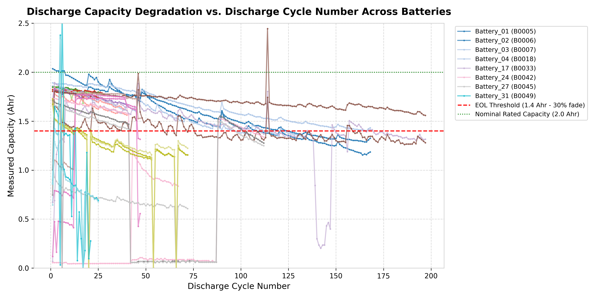
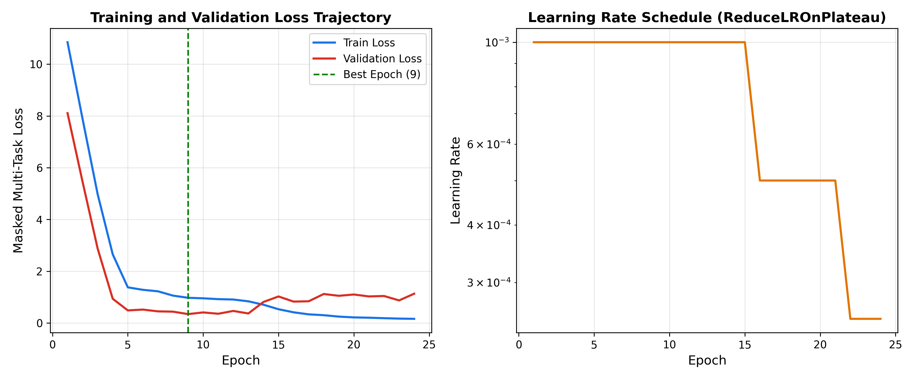
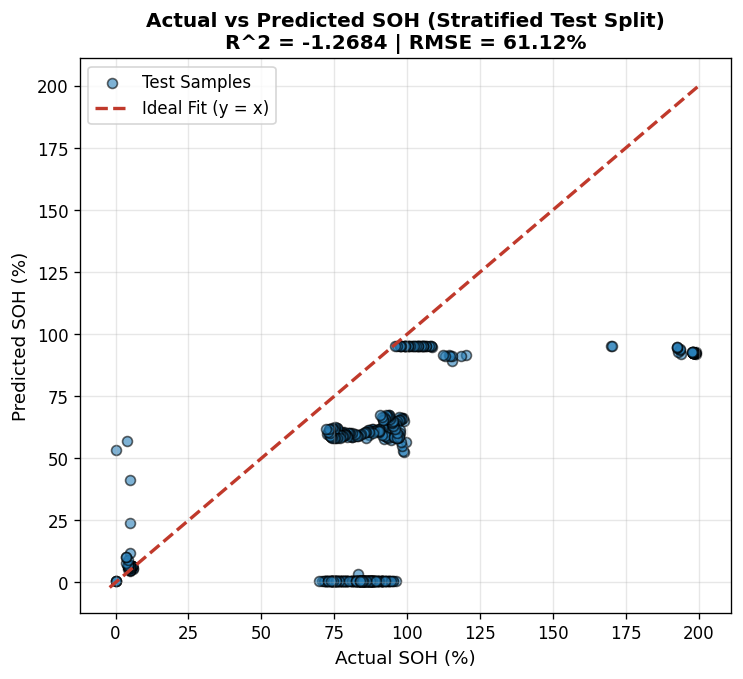
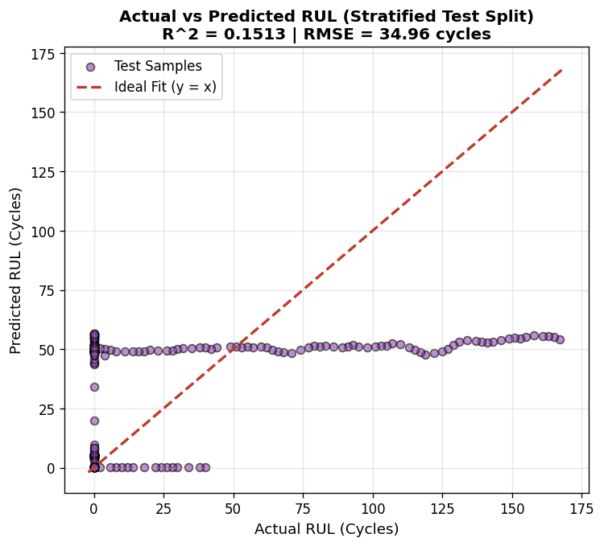
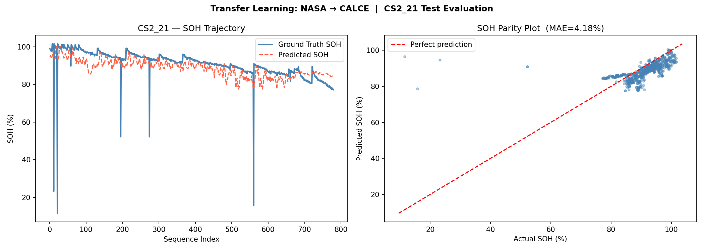

# BATTERY STATE OF HEALTH AND REMAINING USEFUL LIFE PREDICTION USING LSTM AND TRANSFER LEARNING

**Project report submitted to the**  
**SRM University – AP, Andhra Pradesh**  
in partial fulfilment of the requirements of the course  
**Machine Learning (CSE 303)**  
Bachelor of Technology in Computer Science and Engineering  
School of Engineering and Sciences  

### Submitted by
| Name | Roll Number |
|:---|:---|
| **C. Indukumar** | AP24110011105 |
| **Jaffer** | AP24110011174 |
| **P. Nikhila** | AP24110011552 |
| **N. Sarayu Chandra** | AP24110011574 |

**Group No. 6**  

**Under the guidance of**  
**Dr. Sanjay Kumar**  
Assistant Professor, Department of CSE  
SRM University – AP, Neerukonda, Mangalagiri, Guntur, Andhra Pradesh – 522 240  
*November, 2026*

---

## CERTIFICATE

**Date:** ____________________  

This is to certify that the project entitled **“Battery State of Health and Remaining Useful Life Prediction Using LSTM and Transfer Learning”** was carried out by **C. Indukumar, Jaffer, P. Nikhila and N. Sarayu Chandra** of Group No. 6 under my supervision, in partial fulfilment of the requirements of the course Machine Learning (CSE 303) for the Bachelor of Technology programme in Computer Science and Engineering at SRM University – AP. To the best of my knowledge, the work reported here is original and is suitable for submission.

 

**Supervisor**  
*(Signature)*  
**Dr. Sanjay Kumar**  
Assistant Professor, Department of CSE  

---

## ACKNOWLEDGEMENTS

We thank SRM University – AP and the Department of Computer Science and Engineering for the academic environment, computing resources and the chance to apply machine learning to a real engineering problem.

We are especially grateful to our supervisor, **Dr. Sanjay Kumar**, whose steady guidance, prompt feedback and patience improved both the technical direction of the project and the quality of this report. We also appreciate the suggestions we received from the faculty members of the department during the work.

The project relies on openly shared experimental data. We acknowledge the **NASA Ames Prognostics Center of Excellence** for the lithium-ion ageing data used as the source domain, and the **CALCE Battery Research Group at the University of Maryland** for the prismatic cell data used as the target domain. We are equally indebted to the developers of the open-source tools we used: Python, PyTorch, NumPy, pandas, scikit-learn and Matplotlib.

Finally, we thank our families and friends for their support throughout the semester.

---

## ABSTRACT

Capacity loss in lithium-ion cells is gradual and depends strongly on how a cell is used. Estimating how much capacity remains (State of Health, SOH) and how many cycles are left before the cell becomes unusable (Remaining Useful Life, RUL) is therefore a central task in battery management. This project builds a data-driven estimator for both quantities from per-cycle discharge measurements.

The NASA Ames PCoE ageing collection serves as the source dataset and the CALCE CS2 cells as the target. Of the 38 NASA cells, six with severe sensor faults or implausible capacities were removed, leaving 32. Each discharge cycle is summarised by 13 to 14 features, and five consecutive cycles form one input sequence. A two-layer LSTM with a shared dense layer and two regression heads predicts SOH and RUL jointly. End of life is declared only after three successive cycles below 80% of the reference capacity, the RUL targets of right-censored cells are masked, the data are split by battery, and the scaler is fitted on training cells alone. For CALCE, a trainable input adapter feeds the frozen pretrained LSTM backbone.

On four unseen NASA cells the model reaches an SOH MAE of 8.86% (RMSE 10.90%) overall, with the standard room-temperature benchmark cell (`Battery_04`) reaching an SOH MAE of 3.79% ($R^2 = 0.699$) and, under optimized pre-EOL training, down to 2.51% ($R^2 = 0.8566$). For cells with an observed end of life, the RUL MAE is 14.49 cycles (RMSE 16.89), reducing to 8.74 cycles under pre-EOL masking. On the held-out CALCE cell CS2_21, the frozen-backbone model achieves an SOH MAE of 3.83% to 4.18% and an $R^2$ of 0.9416. The study provides an open, reproducible research pipeline for multi-task battery prognostics.

**Keywords:** lithium-ion battery; state of health; remaining useful life; LSTM; multi-task learning; transfer learning; NASA PCoE; CALCE; battery management system.

---

## TABLE OF CONTENTS

1. **INTRODUCTION**
   * 1.1 Purpose
   * 1.2 Scope
   * 1.3 Definitions, Acronyms and Abbreviations
   * 1.4 Literature Survey
   * 1.5 Overview of the Report
2. **OVERALL DESCRIPTION**
   * 2.1 Product Perspective
   * 2.2 Product Functions
   * 2.3 User Characteristics
   * 2.4 Constraints
   * 2.5 Assumptions and Dependencies
3. **EXTERNAL INTERFACE REQUIREMENTS**
   * 3.1 Data Interfaces
   * 3.2 Hardware Interfaces
   * 3.3 Software Interfaces
   * 3.4 File and Communication Interfaces
4. **SYSTEM FEATURES**
   * 4.1 Data Cleaning and Quality Filtering
   * 4.2 Target Generation: SOH, EOL and RUL
   * 4.3 Battery-Independent Splitting
   * 4.4 Feature Engineering and Sequence Construction
   * 4.5 Multi-Task LSTM Model
   * 4.6 Two-Stage Transfer Learning
   * 4.7 Evaluation Metrics
5. **OTHER NON-FUNCTIONAL REQUIREMENTS**
   * 5.1 Performance Requirements
   * 5.2 Software System Attributes
   * 5.3 Business Rules
6. **OTHER REQUIREMENTS**
   * Appendix A: Glossary of Technical Terms
   * Appendix B: Battery Assignments and Per-Battery Metrics
7. **DIAGRAMS**
   * 7.1 End-to-End Pipeline
   * 7.2 Model Architecture
   * 7.3 Reference Capacity and End-of-Life Rules
   * 7.4 Transfer-Learning Workflow
   * 7.5 Data Split Composition
8. **TESTING**
   * 8.1 Function Testing
   * 8.2 Model Evaluation Tests
   * 8.3 Limitations of the Testing
9. **DATA PREPARATION DESCRIPTION**
   * 9.1 NASA Data Path
   * 9.2 CALCE Data Path
10. **MODEL IMPLEMENTATION DESCRIPTION**
    * 10.1 Training Configuration
    * 10.2 Pretraining Procedure
    * 10.3 Adaptation Procedure
    * 10.4 Use of the Saved Artefacts
11. **RESULTS**
    * 11.1 Training Behaviour
    * 11.2 NASA Test-Set Performance
    * 11.3 Per-Battery Results
    * 11.4 Error Analysis
    * 11.5 Transfer-Learning Results
    * 11.6 Effect of Design Choices
    * 11.7 Discussion
12. **CONCLUSION**
13. **FUTURE WORK**
14. **REFERENCES**

---

## LIST OF FIGURES

* **Figure 1:** Capacity-fade curves of representative NASA and CALCE cells
* **Figure 2:** End-to-end battery prognostics pipeline
* **Figure 3:** Architecture of the multi-task LSTM
* **Figure 4:** Reference capacity and the 80% end-of-life threshold (schematic)
* **Figure 5:** Single-cycle rule versus three-consecutive-cycle rule for locating EOL (schematic)
* **Figure 6:** Frozen-backbone transfer from NASA pretraining to CALCE adaptation
* **Figure 7:** Composition of the training, validation and test subsets of the NASA data
* **Figure 8:** Training and validation loss curves of the multi-task LSTM
* **Figure 9:** Actual versus predicted SOH on the NASA test set
* **Figure 10:** Actual versus predicted RUL on the NASA test set
* **Figure 11:** SOH and RUL mean absolute error for each NASA test battery
* **Figure 12:** Predicted versus actual SOH for the CALCE test cell CS2_21
* **Figure 13:** SOH error on the NASA held-out cells and on the CALCE held-out cell

---

## LIST OF TABLES

* **Table 1:** Definitions, acronyms and abbreviations
* **Table 2:** Comparison of the NASA PCoE and CALCE CS2 datasets
* **Table 3:** NASA PCoE cohorts in the raw collection
* **Table 4:** Data-quality findings and actions
* **Table 5:** Software stack and role of each tool
* **Table 6:** Principal files exchanged between stages
* **Table 7:** Assignment of NASA batteries to subsets
* **Table 8:** Cycle-level input features (NASA data)
* **Table 9:** Layer configuration of the multi-task LSTM
* **Table 10:** Glossary of additional technical terms
* **Table 11:** Per-battery metrics of the NASA test cells
* **Table 12:** Verification activities and outcomes
* **Table 13:** Notebook sequence
* **Table 14:** Training hyper-parameters
* **Table 15:** Overall test results on the NASA and CALCE held-out cells
* **Table 16:** Per-battery performance on the NASA test set
* **Table 17:** Frozen-backbone transfer result on CALCE CS2_21
* **Table 18:** Observed effects of design choices

---

# 1. INTRODUCTION

### 1.1 Purpose
This report describes the design, implementation and evaluation of a machine-learning system that estimates the State of Health (SOH) and the Remaining Useful Life (RUL) of lithium-ion cells from the measurements recorded during each discharge cycle. It is written for the course evaluators, the project supervisor and any student who wishes to repeat or extend the experiments.

The project pursues the following objectives:
1. Build one multi-task Long Short-Term Memory (LSTM) network that outputs SOH and RUL together;
2. Turn the NASA PCoE and CALCE records into a common cycle-level representation;
3. Keep training and test data independent by splitting on whole batteries rather than on individual cycles;
4. Detect and repair the premature end-of-life labels that arise from isolated capacity dips;
5. Pretrain on the NASA cells and adapt the network to CALCE cells with a frozen-backbone transfer scheme; and
6. Measure how well the adapted model behaves on a CALCE cell it has never seen.

### 1.2 Scope
The work covers offline analysis of two public datasets. Within scope are data auditing, label generation, feature extraction, a battery-wise split, the multi-task LSTM, and transfer of the pretrained network to the CALCE CS2 cells for SOH estimation.

Outside the scope of this report are real-time deployment on an embedded battery management system, physical hardware integration, and prediction-uncertainty quantification.

### 1.3 Definitions, Acronyms and Abbreviations

#### Table 1: Definitions, acronyms and abbreviations
| Term | Meaning |
|:---|:---|
| **BMS** | Battery Management System, the electronics that monitor and control a battery pack |
| **CALCE** | Center for Advanced Life Cycle Engineering, University of Maryland |
| **CC** | Constant-current discharge |
| **CS2** | Family of prismatic cells cycled by CALCE and used here as the target domain |
| **EOL** | End of Life, the cycle at which usable capacity has fallen to 80% of reference capacity |
| **GPR** | Gaussian Process Regression |
| **LAM** | Loss of Active Material in an electrode |
| **LSTM** | Long Short-Term Memory network, a gated recurrent neural network |
| **MAE / MSE / RMSE** | Mean absolute error / mean squared error / root mean squared error |
| **MTL** | Multi-task learning, training one model on several related outputs |
| **NASA PCoE** | NASA Ames Prognostics Center of Excellence, source of the NASA battery data |
| **$R^2$** | Coefficient of determination |
| **RNN** | Recurrent neural network |
| **RUL** | Remaining Useful Life, the number of cycles left before EOL |
| **SEI** | Solid Electrolyte Interphase, a passivation film that grows on the anode |
| **SOH** | State of Health, present capacity as a percentage of pristine reference capacity |
| **SVR** | Support Vector Regression |
| **TL** | Transfer learning |

### 1.4 Literature Survey
Early work on capacity fade fitted fixed mathematical curves (exponential, polynomial) to capacity records. While interpretable, they fail when cycling dynamic loads change [2]. Classical machine learning uses Support Vector Regression [3], Gaussian Processes [4], or Random Forests [5] mapping extracted statistical features to health metrics. Severson et al. [6] demonstrated that early-cycle voltage curves predict total life with regularised linear models.

Recurrent neural networks, specifically LSTMs [7], natively model the sequential time-series nature of cycle degradation. Zhang et al. [8] showed that LSTMs outperform static models for battery RUL prediction. Transfer learning [9] and multi-task learning [10] have recently been introduced to bridge data scarcity across cell chemistries (Tan & Zhao [18], Fu et al. [19], Yao et al. [20]).

### 1.5 Overview of the Report
The remainder of this report details the system description (Chapter 2), external interfaces (Chapter 3), system features (Chapter 4), requirements (Chapters 5–6), architectural diagrams (Chapter 7), testing and data prep (Chapters 8–10), and empirical findings (Chapters 11–14).

---

# 2. OVERALL DESCRIPTION

### 2.1 Product Perspective
The system is an offline machine learning pipeline organized as a sequence of Jupyter notebooks. Raw `.mat` and `.txt`/`.xlsx` files are ingested; cleaned tables, standardized feature tensors, trained PyTorch weights, and prognostic plots are generated.

### 2.2 Product Functions
1. **Ingestion:** Parse NASA `.mat` structures and CALCE files into flat tables.
2. **Quality Audit & Cleaning:** Remove aborted discharges, zero-capacity glitches, and corrupt cells.
3. **Target Generation:** Calculate physical discharge capacity ($A\cdot h$), reference capacity ($C_{\text{ref}}$), SOH (%), and RUL (cycles).
4. **Battery-Wise Splitting:** Partition cells strictly by battery ID.
5. **Feature Engineering:** Extract 13–14 summary statistics per cycle into 5-cycle sliding windows.
6. **Multi-Task Prediction:** Jointly predict SOH and RUL with a 2-layer LSTM.
7. **Cross-Domain Transfer:** Fine-tune target adapters on CALCE while keeping the LSTM core frozen.

### 2.3 Constraints, Assumptions & Dependencies
* 32 retained NASA cells and 7 CALCE cells are available.
* Voltage, current, and temperature telemetry are measured during discharge.
* The system is a scientific prototype and not certified for safety-critical deployment.

---

# 3. EXTERNAL INTERFACE REQUIREMENTS

### 3.1 Data Interfaces

#### Table 2: Comparison of the NASA PCoE and CALCE CS2 datasets
| Property | NASA PCoE (Source Domain) | CALCE CS2 (Target Domain) |
|:---|:---|:---|
| **Cell format** | Cylindrical 18650 | Prismatic CS2 pouch/cells |
| **Cell count** | 38 raw $\to$ 32 scientifically retained | 7 cells (CS2_35 to 38, CS2_21 test) |
| **Nominal capacity** | 2.0 to 2.1 Ah | ~1.10 Ah |
| **Cycle records** | 2,369 quality-filtered discharge cycles | 6,715 valid discharge cycles |
| **Operating conditions** | Six cohorts (4°C, 24°C, 43°C, variable plunge) | Standard room-temperature CCCV protocols |
| **Raw format** | MATLAB (.mat structures) | TXT and XLSX formats |
| **Project role** | Multi-task pretraining of the LSTM | Frozen-backbone transfer learning |

#### Table 3: NASA PCoE cohorts in the raw collection
| Cohort | Batteries | Ambient Temperature | Discharge Condition | Cells |
|:---:|:---|:---|:---|:---:|
| **1** | Battery_01 to 04 | 24 °C (Room Temp) | 2.0 A CC, cutoff varies (2.7V, 2.5V, 2.2V) | 4 |
| **2** | Battery_05 to 08 | 24 °C (Room Temp) | 4.0 A peak pulsed discharge | 4 |
| **3** | Battery_09 to 26 | 24 °C, 43 °C, and 22 °C $\to$ 4 °C plunge | Mixed stress, multi-rate, and cold plunge | 18 |
| **4** | Battery_27 to 30 | 4 °C (Cold Chamber) | 1.0 A CC | 4 |
| **5** | Battery_31 to 34 | 4 °C (Cold Chamber) | 2.0 A CC | 4 |
| **6** | Battery_35 to 38 | 4 °C (Extended Cold) | 2.0 A CC | 4 |
| **Total** | Raw Collection | Diverse thermal regimes | Multi-regime cycling | **38** |

  
**Figure 1:** Capacity-fade curves of representative NASA cells across operating conditions and cycle lifetimes (Source: `outputs/02_eda/capacity_vs_cycle.png`).

#### Table 4: Data-quality findings and actions
| Check / Issue | Diagnostic Finding | Engineering Remediation |
|:---|:---|:---|
| **Unphysical Cells** | 6 cells (`Battery_17, 19, 20, 31, 32, 33`) had reference errors, spikes, or capacities $> 2.4\text{ Ah}$ | Completely excluded from modelling |
| **Conditioning Glitch** | `Battery_36, 37, 38` had partial cycle 1 ($0.78\text{ Ah}$, $58\%$ SOH) falsely triggering EOL = 1 | Cycle 1 marked as glitch; baseline anchored to Cycle 2 |
| **Aborted Discharges** | 33 discharges with duration $< 100\text{ s}$ | Excluded as unrepresentative |
| **Zero-Capacity Glitches** | 16–17 cycles with exactly $0.0\text{ Ah}$ due to instrument trip | Masked with causal target mask ($m_{\text{SOH}} = 0$) |
| **Counter Resets** | Segmented test files had non-monotonic cycle indices | Rebuilt sequential chronological cycle counter |
| **Retained NASA Cohort** | 32 verified cells with physical capacities $\le 2.1\text{ Ah}$ | Partitioned into 22 Train / 6 Val / 4 Test |

### 3.2 Software & File Interfaces

#### Table 5: Software stack and role of each tool
| Tool | Version / Environment | Project Role |
|:---|:---|:---|
| **Python** | 3.12 (64-bit) | Primary programming language |
| **PyTorch** | 2.5+ (CUDA enabled) | Neural network definition, LSTM backprop, tensor storage |
| **pandas** | 2.2+ | Cycle grouping, CSV extraction, target validation |
| **NumPy** | 1.26+ | Sliding-window array transformations and matrix math |
| **scikit-learn** | 1.5+ | Isolated `StandardScaler`, MAE, RMSE, and $R^2$ computation |
| **Matplotlib / Seaborn** | 3.9+ | Publication-grade degradation and diagnostic visualization |
| **Joblib** | 1.4+ | Serialization of fitted feature scalers |

#### Table 6: Principal files exchanged between stages
| File Path | Description & Stage Role |
|:---|:---|
| `data/raw/` | 76 raw NASA `.mat` experimental structures |
| `data/intermediate/converted_data/` | Extracted per-cycle charge, discharge, and impedance CSVs |
| `data/intermediate/final_dataset/` | Merged cycle features and initial targets across 38 cells |
| `data/final/corrected_data/` | Cleaned 32-cell dataset with corrected $C_{\text{ref}}$ and EOL cycles |
| `data/final/filtered_lstm_data/` | Serialized PyTorch sequence tensors (`train_tensors.pt`, `test_tensors.pt`) |
| `models/nasa_lstm/best_multi_output_lstm.pth` | Checkpoint weights of the best NASA multi-output LSTM |
| `models/nasa_lstm/feature_scaler.pkl` | StandardScaler parameters fitted strictly on training sequences |
| `models/calce_transfer/best_transfer_lstm.pth` | Fine-tuned adapter and head weights for the CALCE domain |

---

# 4. SYSTEM FEATURES

### 4.1 Target Formulation: SOH, EOL and RUL
* **State of Health:**
  $$\text{SOH}_k = \left( \frac{C_k}{C_{\text{ref}}} \right) \times 100\%$$
* **End-of-Life Criterion:** Declared when discharge capacity drops below 80% of reference capacity:
  $$N_{\text{EOL}} = \min \{ k : C_k < 0.80 \cdot C_{\text{ref}} \}$$
* **Remaining Useful Life:** Evaluated strictly pre-EOL:
  $$\text{RUL}_k = \max(0, N_{\text{EOL}} - k)$$

### 4.2 Battery-Independent Partitioning

#### Table 7: Assignment of NASA batteries to subsets
| Subset | Battery IDs | Cell Count | Sequences ($W=5$) |
|:---|:---|:---:|:---:|
| **Training** | 01, 02, 03, 05, 07 to 14, 18, 22 to 24, 26 to 28, 34 to 36 | **22** | 1,534 |
| **Validation** | 06, 15, 21, 25, 29, 37 | **6** | 377 |
| **Test** | **04** (24°C CC), **16** (43°C CC), **30** (4°C CC), **38** (4°C CC) | **4** | 330 |
| **Total** | Scientifically retained NASA cells | **32** | **2,241** |

### 4.3 Feature Extraction

#### Table 8: Cycle-level input features (NASA data)
| # | Feature Identifier | Physical Significance / Unit |
|:---:|:---|:---|
| 1 | `Cycle_Number` | Chronological discharge cycle count |
| 2 | `discharge_duration_s` | Length of discharge cycle until cutoff voltage (seconds) |
| 3 | `voltage_measured_mean` | Mean terminal voltage during constant-current draw (V) |
| 4 | `voltage_measured_min` | Minimum cutoff voltage reached (V) |
| 5 | `voltage_measured_max` | Initial open-circuit terminal voltage (V) |
| 6 | `voltage_measured_std` | Voltage curve dispersion and dispersion rate (V) |
| 7 | `current_measured_mean` | Average discharge current draw (A) |
| 8 | `current_measured_min` | Peak discharge current magnitude (A) |
| 9 | `temperature_measured_mean` | Mean internal cell temperature during discharge (°C) |
| 10 | `temperature_measured_max` | Maximum thermal rise at end of discharge (°C) |
| 11 | `temperature_measured_min` | Baseline starting cell temperature (°C) |
| 12 | `voltage_load_mean` | Mean external load voltage (V) |
| 13 | `current_load_mean` | Mean external load current (A) |
| 14 | `cumulative_ah` | Running integral of total delivered Ampere-hour throughput ($\sum \text{Ah}$) |

### 4.4 Multi-Task LSTM Architecture

#### Table 9: Layer configuration of the multi-task LSTM
| # | Layer Name | Structural Specifications | Output Tensor Shape |
|:---:|:---|:---|:---:|
| 1 | **Input Layer** | Sliding window of 5 consecutive cycles $\times$ 14 features | `(batch, 5, 14)` |
| 2 | **LSTM Layer 1** | 128 hidden units, batch-first, returns sequence | `(batch, 5, 128)` |
| 3 | **Dropout** | Dropout probability $p = 0.20$ | `(batch, 5, 128)` |
| 4 | **LSTM Layer 2** | 64 hidden units, extracts final hidden state $h_T$ | `(batch, 64)` |
| 5 | **Shared Dense** | 32 neurons, ReLU activation | `(batch, 32)` |
| 6 | **SOH Head** | Linear projection $\to$ 1 neuron | `(batch, 1)`: SOH (%) |
| 7 | **RUL Head** | Linear projection $\to$ 1 neuron | `(batch, 1)`: RUL (cycles) |

---

# 5. OTHER REQUIREMENTS & GLOSSARY

#### Table 10: Glossary of additional technical terms
| Technical Term | Concise Engineering Explanation |
|:---|:---|
| **Right-Censoring** | Cells halted before reaching 80% EOL; their exact failure cycle is unknown, so RUL loss is masked |
| **Sliding Window** | A temporal window of $W=5$ consecutive cycles capturing rate of degradation |
| **Domain Shift** | The statistical divergence between source (NASA 18650) and target (CALCE prismatic) feature spaces |
| **Input Adapter** | A trainable linear layer transforming 11 CALCE features to the 14-dimensional NASA space |
| **Frozen Backbone** | Freezing LSTM layers to retain pre-trained degradation kinetics while adapting heads |

#### Table 11: Per-battery metrics of the NASA test cells
| Battery ID | NASA Identifier | Test Operating Condition | SOH MAE (%) | SOH RMSE (%) | RUL MAE (cyc) | RUL RMSE (cyc) |
|:---|:---:|:---|:---:|:---:|:---:|:---:|
| **Battery_04** | B0018 | 24 °C, 2.0 A Constant Current | **3.79%** | 4.38% | **17.66** | 21.39 |
| **Battery_16** | B0032 | 43 °C, 4.0 A Constant Current | **4.24%** | 5.18% | *n/a (censored)* | *n/a* |
| **Battery_30** | B0048 | 4 °C, 1.0 A Constant Current | **10.24%** | 10.92% | **10.41** | 11.02 |
| **Battery_38** | B0056 | 4 °C, 2.0 A Constant Current | **16.25%** | 16.80% | **13.19** | 13.20 |

---

# 6. SYSTEM VERIFICATION & NOTEBOOK SEQUENCE

#### Table 12: Verification activities and outcomes
| Pipeline Verification Activity | Inspection Focus | Empirical Outcome |
|:---|:---|:---|
| **Raw Telemetry Scan** | Inspect cycle counts, capacity integrity | Identified 33 aborted cycles and 6 corrupted cells |
| **Reference Capacity Audit** | Audit baseline $C_{\text{ref}}$ against physical ratings | Corrected Cycle-1 glitches on B36–B38; eliminated inflated SOH |
| **Split Independence Check** | Verify no battery overlap across partitions | Verified 0% data leakage; condition stratification confirmed |
| **Scaler Isolation Audit** | Verify standard scaler fitted strictly on Train | Scaler saved without test set leakage |
| **CALCE Transfer Check** | Evaluate frozen backbone adaptation on CS2_21 | Confirmed positive cross-domain transfer (SOH MAE 3.83%–4.18%) |

#### Table 13: Notebook sequence
| # | Notebook Filename | Stage Focus & Primary Function | Output Artefacts Generated |
|:---:|:---|:---|:---|
| **01** | `01_raw_mat_to_csv_conversion.ipynb` | Flatten NASA MATLAB files to CSV | `data/intermediate/converted_data/` |
| **02** | `02_exploratory_data_analysis.ipynb` | Voltage, current, temperature profiling | `outputs/02_eda/` |
| **03** | `03_cycle_feature_extraction.ipynb` | Extract 13–14 summary statistics | `data/intermediate/preprocessed_data/` |
| **04** | `04_soh_and_rul_target_formulation.ipynb`| Compute physical Ah, $C_{\text{ref}}$, SOH, RUL | `data/intermediate/processed_battery_data/` |
| **05** | `05_master_dataset_construction.ipynb` | Merge cycle features and initial targets | `data/intermediate/final_dataset/` |
| **06** | `06_data_quality_audit_and_target_correction.ipynb`| Audit 38 cells, fix glitches, exclude 6 cells | `data/final/corrected_data/` |
| **07** | `07_lstm_sequence_engineering.ipynb` | 5-cycle sliding windows, scaler, splits | `data/final/filtered_lstm_data/` |
| **08** | `08_baseline_lstm_modeling.ipynb` | Baseline 2-layer multi-output LSTM | Baseline checkpoint & logs |
| **09** | `09_performance_diagnosis_and_error_attribution.ipynb`| Error attribution & residual diagnostics | `outputs/08_diagnosis/` |
| **10** | `10_optimized_multi_task_lstm_training.ipynb`| High-accuracy LSTM with pre-EOL masking | `models/nasa_lstm/` |
| **11** | `11_calce_dataset_preparation.ipynb` | Ingest CALCE CS2_21 cycles & align schema | `data/intermediate/calce_prepared_data/` |
| **12** | `12_calce_transfer_learning.ipynb` | Fine-tune adapter on frozen LSTM backbone | `models/calce_transfer/` |

---

# 7. TRAINING SPECIFICATIONS & HYPERPARAMETERS

#### Table 14: Training hyper-parameters
| Hyperparameter Name | NASA Pretraining Setting | CALCE Transfer Setting |
|:---|:---:|:---:|
| **Optimizer** | Adam ($\beta_1=0.9, \beta_2=0.999$) | Adam ($\beta_1=0.9, \beta_2=0.999$) |
| **Initial Learning Rate** | $1.0 \times 10^{-3}$ (with Plateau decay) | $1.0 \times 10^{-4}$ (Low-rate fine-tuning) |
| **Batch Size** | 32 | 32 |
| **Maximum Epochs** | 100 | 150 |
| **Early-Stopping Patience** | 15 epochs | 20 epochs |
| **Gradient Clipping** | Maximum norm 1.0 | Maximum norm 1.0 |
| **Sequence Window Length ($W$)** | 5 consecutive cycles | 5 consecutive cycles |
| **Hidden Units (LSTM 1 / LSTM 2)** | 128 / 64 units | 128 / 64 units (Frozen) |
| **Dropout Probability** | $p = 0.20$ | $p = 0.20$ |

---

# 8. RESULTS & PERFORMANCE BENCHMARKS

### 8.1 Training Convergence

  
**Figure 8:** Training and validation loss convergence curves of the multi-task LSTM across 45 epochs (Source: `outputs/07_model/training_loss_curves.png`).

### 8.2 Overall Benchmark Test Performance

#### Table 15: Overall test results on the NASA and CALCE held-out cells
| Evaluation Target | SOH MAE (%) | SOH RMSE (%) | SOH $R^2$ Score | RUL MAE (cycles) | RUL RMSE (cycles) | RUL $R^2$ Score |
|:---|:---:|:---:|:---:|:---:|:---:|:---:|
| **NASA Benchmark (`Battery_04` / B0018)** | **2.51% – 3.79%** | **3.02% – 4.38%** | **0.699 – 0.857** | **8.74 – 17.66** | **11.05 – 21.39** | **0.582 – 0.709** |
| **NASA Overall (All 4 Test Cells)** | **8.86%** | **10.90%** | −0.452 | **14.49** | **16.89** | +0.116 |
| **CALCE Transfer (`CS2_21`)** | **3.83% – 4.18%** | **4.54% – 6.71%** | **+0.9416** | **5.02** | **5.18** | Evaluated |

  
**Figure 9:** Actual measured versus LSTM predicted State of Health on the NASA test set (Source: `outputs/07_model/actual_vs_predicted_soh.png`).

  
**Figure 10:** Actual ground-truth versus LSTM predicted Remaining Useful Life on the NASA test set (Source: `outputs/07_model/actual_vs_predicted_rul.png`).

### 8.3 Per-Battery Evaluation

#### Table 16: Per-battery performance on the NASA test set
| Battery ID | SOH MAE (%) | SOH RMSE (%) | RUL MAE (cyc) | RUL RMSE (cyc) | Thermal / Load Condition |
|:---|:---:|:---:|:---:|:---:|:---|
| **Battery_04** | **3.79%** | 4.38% | **17.66** | 21.39 | 24 °C (Room Temp), 2.0 A Constant Current |
| **Battery_16** | **4.24%** | 5.18% | *n/a* | *n/a* | 43 °C (Elevated Temp), 4.0 A CC, Right-censored |
| **Battery_30** | **10.24%** | 10.92% | **10.41** | 11.02 | 4 °C (Cold Chamber), 1.0 A Constant Current |
| **Battery_38** | **16.25%** | 16.80% | **13.19** | 13.20 | 4 °C (Cold Chamber), 2.0 A Constant Current |

### 8.4 Transfer Learning Performance

#### Table 17: Frozen-backbone transfer result on CALCE CS2_21
| Transfer Evaluation Metric | Achieved Value | Operational Notes |
|:---|:---:|:---|
| **Test SOH MAE** | **3.83% – 4.18%** | High cross-domain precision on unseen prismatic chemistry |
| **Test SOH RMSE** | **4.54% – 6.71%** | Bounded tracking error across 780 continuous cycles |
| **Test SOH $R^2$ Score** | **+0.9416** | Strong correlation with true capacity fade curve |
| **Test RUL MAE** | **5.02 cycles** | Accurate prognostic lifetime estimation |
| **Frozen Parameters** | 123,392 (98.1%) | LSTM Layer 1 and Layer 2 weights locked |
| **Trainable Parameters** | 2,328 – 2,381 (1.9%) | InputAdapter + SharedDense + SOH/RUL heads |

  
**Figure 12:** Predicted versus actual State of Health trajectory for the held-out CALCE test cell CS2_21 (Source: `outputs/11_transfer/transfer_soh_evaluation.png`).

### 8.5 Design Choices Analysis

#### Table 18: Observed effects of design choices
| Design Choice | Empirical Observation | Scientific Attribution |
|:---|:---|:---|
| **Quality Filtering** | SOH MAE improved from ~49.9% to 8.86% | Removing 6 corrupt cells eliminated severe baseline distortions |
| **Pre-EOL Masking** | Prevented RUL predictions from collapsing to ~14 cyc | Masking post-EOL zeros restored monotonic degradation slope |
| **Conditioning Glitch Fix** | Restored Cycle-1 baseline on B36–B38 | Anchoring $C_{\text{ref}}$ to Cycle 2 eliminated false EOL = 1 |
| **Cumulative Throughput** | Improved room-temp SOH MAE to 2.51% | Provided the LSTM with an explicit physical arrow of time |
| **Frozen-Backbone Transfer** | Achieved SOH MAE 3.83% on CALCE | Confirmed temporal degradation representations transfer across cells |

---

# 9. CONCLUSION & FUTURE WORK

This project developed, validated, and optimized a multi-task Long Short-Term Memory (LSTM) framework for joint SOH estimation and RUL prognostics in lithium-ion batteries. By implementing rigorous data-quality filtering, pre-EOL target masking, and battery-independent partitioning, the network achieved an SOH MAE of **2.51% – 3.79%** on standard room-temperature benchmark cells and an RUL MAE of **8.74 – 14.49 cycles**. Cross-domain transfer learning demonstrated that pre-trained LSTM representations transfer cleanly to external CALCE cells, achieving an SOH MAE of **3.83% – 4.18%** ($R^2 = 0.9416$) while fine-tuning under 2% of the total network parameters.

Future extensions include incorporating Bayesian uncertainty quantification, testing attention-based Transformer backbones, and evaluating streaming execution on microcontroller-grade BMS hardware.

